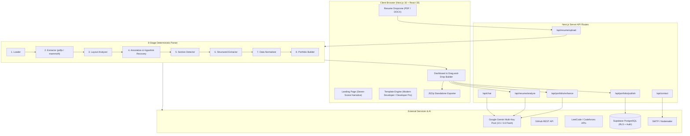

<div align="center">

# ✦ DevCanvas

### *Turn your resume into an iconic developer portfolio website in seconds.*

An enterprise-grade, open-source Platform-as-a-Service (PaaS) that parses unstructured resumes (PDF/DOCX) through an 8-stage deterministic extraction engine, enriches candidate profiles with live GitHub & competitive programming telemetry, runs deep ATS job-matching diagnostics via Google Gemini, and compiles bespoke, high-performance web portfolios with zero vendor lock-in.

[](https://nextjs.org/)
[](https://react.dev/)
[](https://www.typescriptlang.org/)
[](https://tailwindcss.com/)
[](https://supabase.com/)
[](https://aistudio.google.com/)
[](https://threejs.org/)
[](LICENSE)

[Live Demo](https://dev-canvas-ia.vercel.app) • [Architecture](#-system-architecture) • [Features](#-core-features) • [Getting Started](#-getting-started) • [API Docs](#-api-reference) • [Templates](#-handcrafted-templates)

</div>

---

## 🌟 Executive Summary

Most developer portfolios remain stuck in the past: cookie-cutter templates that fail to showcase technical depth, require tedious manual upkeep, and take weeks to build from scratch.

**DevCanvas solves this completely:**
1. **Drop in your resume** (PDF or DOCX).
2. **Deterministic 8-stage pipeline** extracts and normalizes projects, skills, education, experience, and contact details without hallucinating.
3. **Multi-platform telemetry crawler** concurrently queries GitHub, LeetCode, Codeforces, and CodeChef to pull live repositories, stars, and competitive rankings.
4. **ATS & Job Match Analyzer** evaluates your profile against target Job Descriptions with real-time gap analysis and Gemini-powered rewrite recommendations.
5. **Publish to a public custom slug** (`dev-canvas-ia.vercel.app/<username>`) or **Export as a zero-dependency standalone ZIP package** deployable to GitHub Pages, Cloudflare Pages, Netlify, or AWS S3.

---

## 🚀 Core Features

### 1. ⚡ 8-Stage Deterministic Resume Pipeline
Unlike brittle single-shot LLM parsers, DevCanvas utilizes a resilient, multi-stage hybrid engine:
- **Stage 1 (Loader)**: Low-level binary PDF/DOCX validation, buffer ingestion, and security bounding.
- **Stage 2 (Extractor)**: Extracts positioned text glyphs and tokens with spatial coordinate awareness using `pdfjs-dist` and `mammoth`.
- **Stage 3 (Layout Analysis)**: Reconstructs reading orders, multi-column layouts, and bounding boxes.
- **Stage 4 (Annotation & Hyperlink Recovery)**: Extracts embedded URI hyperlinks (GitHub links, project demos, LinkedIn profiles) that standard parsers drop.
- **Stage 5 (Section Detection)**: Heuristic boundary detection identifying Experience, Projects, Education, Skills, and Certifications.
- **Stage 6 (Structured Extraction)**: Entity extraction mapping items into strongly typed schema models.
- **Stage 7 (Data Normalizer)**: Date standardization, title normalization, and deduplication.
- **Stage 8 (Portfolio Builder)**: Assembles the final, validated `PortfolioData` object ready for immediate rendering.

### 2. 🌐 Multi-Platform Profile Telemetry
DevCanvas automatically detects external platform handles in resumes and enriches profiles asynchronously:
- **GitHub**: Bio, avatar, repository count, follower counts, and top 8 repositories sorted by activity and stars.
- **Competitive Programming**:
  - **LeetCode**: Real-time solved problems count, global ranking, and tier badge (Guardian, Knight, Member).
  - **Codeforces**: Current rating, peak rating, and competitive rank (Grandmaster, Master, Candidate Master, Specialist, etc.).
  - **CodeChef & HackerRank**: Profile rating and badge synchronization.
- **External Websites**: Scrapes OpenGraph metadata and screenshots for linked portfolio or project demo URLs.

### 3. 🎯 Deep ATS Scanner & Job Match Engine
Compare your resume directly against any Job Description:
- **Multi-Dimensional Scoring**: Aggregate match percentage broken down into *Skills Match*, *Experience Alignment*, *Education Match*, and *ATS Keyword Density*.
- **Gap & Critical Skill Analysis**: Differentiates between critical required skills vs. nice-to-have qualifications.
- **Actionable Rewrite Suggestions**: Prioritized suggestions (High, Medium, Low) with clear impact explanations.
- **ATS Readiness Report**: Identifies formatting red flags and unstated requirements.

### 4. 🤖 Resilient Gemini AI Integration
- **Key-Rotation Pool**: Supports round-robin rotation across up to 20 Google Gemini API keys to effortlessly handle high concurrency and prevent rate limits.
- **Automated Fallback Cascade**: Gracefully transitions across `gemini-3.5-flash`, `gemini-3.6-flash`, and `gemini-flash-latest`.
- **429 & 503 Self-Healing**: Automated exponential backoff and transparent key swapping upon encountering rate limits or server load.
- **Strict Copywriting Mode**: Enhances project bullet points and achievement narratives into high-impact portfolio copy while strictly forbidding hallucination of technologies or credentials.

### 5. 🎨 Bespoke Developer Templates
- **Modern Developer**: High-end dark theme featuring a dynamic Three.js canvas background, interactive GitHub contribution calendar, categorized skill tags, project modal showcases, and integrated contact form.
- **Developer Pro**: VS Code / IDE terminal aesthetic equipped with a sidebar file tree, simulated code editor view, status bar, and keyboard shortcuts.
- **Creative Edge**: Bold gradients, expressive typography, and artistic micro-interactions designed for design engineers and creative technologists.

### 6. 📦 Zero Vendor Lock-in (Standalone ZIP Export)
- Download your entire portfolio as a 100% self-contained, standalone static package (`.zip`) created on-the-fly with `JSZip`.
- Zero build tools required: includes clean HTML5, modern vanilla CSS, responsive layouts, and vanilla JS.
- Host anywhere instantly for free: **GitHub Pages**, **Vercel**, **Netlify**, **Render**, or **Cloudflare Pages**.

### 7. 🔒 Full Authentication & Database Security
- Powered by **Supabase** with **Row Level Security (RLS)**.
- Secure CRUD operations guaranteeing users can only read, edit, or delete their own portfolio drafts.
- Public slug routes (`/[slug]`) permit instantaneous, high-performance rendering of published portfolios.

---

## 🏗️ System Architecture



---

## 📂 Project Directory Structure

```text
DevCanvas/
├── public/                     # Static assets, icons, fonts, showcase images
├── src/
│   ├── app/                    # Next.js 16 App Router
│   │   ├── [slug]/             # Public dynamic portfolio routes (/username)
│   │   ├── about/              # Brand philosophy, team & architecture story
│   │   ├── api/                # Backend API endpoints
│   │   │   ├── chat/           # DevCanvas Assistant AI support route
│   │   │   ├── contact/        # SMTP email dispatch via Nodemailer
│   │   │   ├── dev-login/      # Developer bypass authentication route
│   │   │   ├── github/         # GitHub contributions & telemetry proxy
│   │   │   ├── portfolio/      # Save, enhance, slug, and publish endpoints
│   │   │   └── resume/         # Resume upload, parse, and ATS analyze routes
│   │   ├── auth/               # Supabase OAuth and email auth callbacks
│   │   ├── contact/            # Platform contact inquiry page
│   │   ├── dashboard/          # Authenticated user control center
│   │   │   ├── (main)/         # Main layout group (overview, analytics, domains, theme)
│   │   │   ├── builder/        # Real-time drag-and-drop portfolio builder
│   │   │   ├── preview/        # Live responsive iframe/full preview
│   │   │   └── profile/        # Identity Core configuration
│   │   ├── preview/[id]/       # Authenticated portfolio draft preview
│   │   ├── signin/             # User sign-in interface
│   │   ├── signup/             # User registration interface
│   │   ├── templates/          # Showcase template viewer
│   │   ├── works/              # Curated template gallery
│   │   ├── globals.css         # Global styling and Tailwind v4 theme definitions
│   │   ├── layout.tsx          # Root layout with font optimization & chat widget
│   │   └── page.tsx            # DevCanvas Seven-Scene interactive landing page
│   ├── components/             # Reusable UI components
│   │   ├── chat/               # Floating AI support chat widget
│   │   ├── dashboard/          # Analytics charts, profile managers, navbars
│   │   ├── landing/            # Landing scenes (Header, Story, Workflow, Finale)
│   │   ├── templates/          # Portfolio rendering layouts
│   │   │   ├── DeveloperPro/   # IDE/Terminal dark theme layout
│   │   │   └── ModernDeveloper/# Three.js 3D dark theme layout
│   │   ├── ui/                 # Dropdowns, modal dialogs, buttons, toggles
│   │   ├── DownloadZipButton.tsx # Client-side JSZip portfolio bundler
│   │   ├── ResumeUploader.tsx  # Full-featured drag-and-drop resume pipeline UI
│   │   └── ThemeProvider.tsx   # Next-themes dark/light context provider
│   ├── context/
│   │   └── AuthContext.tsx     # Supabase user authentication provider & hooks
│   ├── lib/
│   │   ├── resume/             # 8-Stage resume parsing pipeline
│   │   │   ├── enricher/       # GitHub, LeetCode, Codeforces concurrent crawlers
│   │   │   ├── pipeline/       # Loader, extractor, layout, annotations, normalizer
│   │   │   └── jobAnalyzer.ts  # ATS scoring, keyword density, and gap engine
│   │   ├── llm.ts              # Gemini multi-key balancer, retry & fallback system
│   │   └── templates.ts        # Template metadata and configuration definitions
│   ├── types/
│   │   └── portfolio.ts        # Core TypeScript interfaces for portfolio data
│   └── utils/
│       ├── exportPortfolioZip.js # Self-contained HTML/CSS/JS export generator
│       └── supabase/           # Client, Server, and Middleware Supabase helpers
├── supabase/
│   └── migrations/             # SQL schema migrations (portfolios, slugs, RLS)
├── .env.example                # Sample environment variables with descriptions
├── package.json                # Project dependencies and script declarations
├── tailwind.config.ts          # Tailwind CSS styling configuration
└── tsconfig.json               # TypeScript configuration
```

---

## 🛠️ Tech Stack & Dependencies

| Layer | Technology | Purpose |
| :--- | :--- | :--- |
| **Framework** | [Next.js 16 (App Router)](https://nextjs.org/) | Hybrid Server & Client Rendering, API Routes |
| **Language** | [TypeScript 5](https://www.typescriptlang.org/) | End-to-end type safety |
| **UI Library** | [React 19](https://react.dev/) | Component architecture & modern hooks |
| **Styling** | [Tailwind CSS v4](https://tailwindcss.com/) | High-performance CSS engine |
| **3D & Canvas** | [Three.js](https://threejs.org/) & [R3F](https://r3f.docs.pmnd.rs/) | 3D interactive portfolio background |
| **Motion** | [Framer Motion](https://www.framer.com/motion/) | Smooth layout and scene transitions |
| **Database & Auth** | [Supabase](https://supabase.com/) | PostgreSQL with Row-Level Security & Auth |
| **Artificial Intelligence** | [Google Generative AI](https://ai.google.dev/) | Gemini Flash LLM multi-key rotation engine |
| **Document Parsing** | `pdfjs-dist`, `pdf-parse`, `mammoth` | PDF & Word document text and coordinate extraction |
| **Icons** | [Lucide React](https://lucide.dev/) | Clean, accessible iconography |
| **Bundling** | [JSZip](https://stuk.github.io/jszip/) | Client-side standalone static website compression |
| **Drag & Drop** | [@dnd-kit](https://dndkit.com/) | Accessible drag-and-drop builder components |
| **Mailing** | [Nodemailer](https://nodemailer.com/) | Contact form delivery to developer inboxes |

---

## 🚦 Getting Started

### Prerequisites

Ensure you have the following installed on your machine:
- **Node.js**: `v20.0.0` or higher (Node 22 LTS recommended)
- **Package Manager**: `npm`, `pnpm`, or `bun`
- **Git**

---

### Step 1: Clone the Repository

```bash
git clone https://github.com/Ishan-Gupta1012/Dev-Canvas.git
cd Dev-Canvas
```

---

### Step 2: Install Dependencies

```bash
npm install
```

---

### Step 3: Configure Environment Variables

Duplicate the `.env.example` file to create `.env.local`:

```bash
cp .env.example .env.local
```

Open `.env.local` and populate the values:

```env
# -----------------------------------------------------------------------------
# Supabase Configuration
# -----------------------------------------------------------------------------
NEXT_PUBLIC_SUPABASE_URL=https://your-project-id.supabase.co
NEXT_PUBLIC_SUPABASE_ANON_KEY=your-supabase-anon-key

# -----------------------------------------------------------------------------
# Google Gemini AI Configuration
# -----------------------------------------------------------------------------
GEMINI_API_KEY=your-gemini-api-key
# Optional: Multi-key pooling for high-concurrency rate-limit failover
# GEMINI_API_KEY_1=your-second-gemini-key
# GEMINI_API_KEY_2=your-third-gemini-key

# -----------------------------------------------------------------------------
# GitHub Telemetry (Optional)
# Boosts unauthenticated 60 req/hr limit to 5,000 req/hr
# -----------------------------------------------------------------------------
GITHUB_TOKEN=your-github-personal-access-token

# -----------------------------------------------------------------------------
# Contact Form & Email Dispatch (Optional)
# -----------------------------------------------------------------------------
EMAIL_USER=your-email@gmail.com
EMAIL_PASS=your-gmail-app-password
```

> [!TIP]
> **Don't have a Gemini key?** You can get a free API key at [Google AI Studio](https://aistudio.google.com/). The application runs in demo fallback mode if no key is provided.

---

### Step 4: Setup Database (Supabase)

1. Navigate to your [Supabase Dashboard](https://supabase.com/dashboard).
2. Open the **SQL Editor** tab.
3. Paste and run the contents of [`supabase_portfolios_schema.sql`](file:///Users/ishangupta/Documents/Projects%20/PaaS/supabase_portfolios_schema.sql):
   ```sql
   create table if not exists public.portfolios (
     id uuid default gen_random_uuid() primary key,
     user_id uuid not null references auth.users(id) on delete cascade,
     title text not null,
     template_name text not null,
     data jsonb not null,
     status text not null default 'draft' check (status in ('draft', 'published')),
     slug text unique,
     created_at timestamp with time zone default timezone('utc'::text, now()) not null,
     updated_at timestamp with time zone default timezone('utc'::text, now()) not null
   );

   alter table public.portfolios enable row level security;

   create policy "Users can view their own portfolios" on public.portfolios for select using (auth.uid() = user_id);
   create policy "Users can insert their own portfolios" on public.portfolios for insert with check (auth.uid() = user_id);
   create policy "Users can update their own portfolios" on public.portfolios for update using (auth.uid() = user_id);
   create policy "Users can delete their own portfolios" on public.portfolios for delete using (auth.uid() = user_id);

   create index if not exists portfolios_user_id_idx on public.portfolios(user_id);
   create index if not exists idx_portfolios_slug on public.portfolios(slug);
   ```

---

### Step 5: Launch Development Server

```bash
npm run dev
```

Open [http://localhost:3000](http://localhost:3000) in your browser.

---

## 🎨 Handcrafted Templates

| Template | Aesthetic | Highlights | Target Audience |
| :--- | :--- | :--- | :--- |
| **Modern Developer** | Dark / Luminescent | • Three.js 3D canvas background<br>• Real-time GitHub contribution graph<br>• Interactive skills matrix<br>• Project showcase with video modals | Full-Stack Engineers, Frontend Developers, Mobile Devs |
| **Developer Pro** | VS Code / Terminal | • Authentic IDE file explorer tree<br>• Tabbed syntax-highlighted code editor<br>• Terminal status bar & telemetry<br>• Monospace typography | Systems Programmers, Backend Developers, DevOps/SREs |
| **Creative Edge** | Avant-Garde / Gradient | • Bold typographic hierarchy<br>• Liquid gradient headers<br>• Playful micro-interactions<br>• Clean light/dark responsiveness | Creative Technologists, UI/UX Engineers, Design Technologists |

---

## 🔌 API Reference

### 1. `POST /api/resume/upload`
Uploads and processes a resume file through the 8-stage pipeline with external profile enrichment.

- **Content-Type**: `multipart/form-data`
- **Payload**:
  - `file`: PDF or DOCX binary file (Max 5MB).
- **Response**:
  ```json
  {
    "success": true,
    "resumeData": {
      "personal": { "name": "Jane Doe", "role": "Senior Software Engineer" },
      "experience": [...],
      "projects": [...],
      "skills": [...]
    },
    "externalData": {
      "github": [{ "username": "janedoe", "publicReposCount": 42 }],
      "coding": [{ "platform": "leetcode", "solvedCount": 480, "rank": "Knight" }]
    }
  }
  ```

---

### 2. `POST /api/resume/analyze`
Scans a candidate resume against a target job description and returns an in-depth ATS match evaluation.

- **Content-Type**: `application/json` or `multipart/form-data`
- **JSON Body**:
  ```json
  {
    "resumeText": "...",
    "jobData": {
      "title": "Staff Frontend Engineer",
      "requiredSkills": ["TypeScript", "Next.js", "GraphQL"],
      "description": "..."
    }
  }
  ```
- **Response**:
  ```json
  {
    "success": true,
    "data": {
      "matchScore": 88,
      "scoreBreakdown": { "skillsScore": 92, "experienceScore": 85, "educationScore": 90, "keywordScore": 84 },
      "matchingSkills": [...],
      "missingSkills": [{ "name": "GraphQL", "importance": "critical" }],
      "suggestions": [
        {
          "priority": "high",
          "category": "skills",
          "title": "Highlight GraphQL query optimization",
          "action": "Add quantifiable impact in experience section",
          "impact": "Boosts ATS match by ~8%"
        }
      ]
    }
  }
  ```

---

### 3. `POST /api/portfolio/enhance`
Enhances candidate project bullets and career achievements into punchy, high-impact portfolio copy using Google Gemini Flash.

- **Content-Type**: `application/json`
- **JSON Body**:
  ```json
  {
    "resumeData": { "experience": [...], "projects": [...] }
  }
  ```
- **Response**:
  ```json
  {
    "success": true,
    "enhancedData": { ... }
  }
  ```

---

### 4. `POST /api/chat`
Streams or generates intelligent contextual answers from the built-in **DevCanvas Assistant**.

- **Content-Type**: `application/json`
- **JSON Body**: `{ "message": "How do I deploy my exported ZIP file to GitHub Pages?" }`
- **Response**: `{ "response": "To deploy your exported DevCanvas ZIP to GitHub Pages:\n1. Unzip the file..." }`

---

## 🚢 Production Deployment

### Option A: Deploy to Vercel (Recommended)

1. Push your repository to GitHub / GitLab.
2. Import the project into [Vercel](https://vercel.com/new).
3. Set the environment variables configured in `.env.local`:
   - `NEXT_PUBLIC_SUPABASE_URL`
   - `NEXT_PUBLIC_SUPABASE_ANON_KEY`
   - `GEMINI_API_KEY`
   - `GITHUB_TOKEN` (optional)
   - `EMAIL_USER` & `EMAIL_PASS` (optional)
4. Click **Deploy**. Vercel will automatically build the Next.js 16 project.

---

### Option B: Export Standalone Static Portfolio

1. Inside your DevCanvas Dashboard, select **Export**.
2. Click **Download ZIP**.
3. DevCanvas bundles your chosen template, your populated resume data, styles, and scripts into a standalone package.
4. Drag and drop the extracted folder into **Netlify Drop**, **Cloudflare Pages**, or push to a `gh-pages` branch on GitHub!

---

## 🛡️ Security & Privacy

- **Row Level Security (RLS)**: Enforced across all Supabase database tables to ensure zero data leaks between users.
- **Zero Document Retention**: Uploaded resumes are processed in memory and never stored as raw files on the server.
- **API Key Safeguards**: Gemini API keys and GitHub tokens are kept exclusively in server-side runtime environments and never exposed to the client bundle.

---

## 👥 Meet the Creators

<table align="center">
  <tr>
    <td align="center" width="200">
      <br />
      <b>Ishan Gupta</b><br />
      <sub>Founder & Core Architect</sub><br />
      <a href="https://www.linkedin.com/in/ishan-gupta-08686631a/">LinkedIn</a> • <a href="https://github.com/Ishan-Gupta1012">GitHub</a>
    </td>
    <td align="center" width="200">
      <br />
      <b>Aparna Jha</b><br />
      <sub>Product Design Lead</sub><br />
      <a href="https://www.linkedin.com/in/aparna-jha-58662b304/">LinkedIn</a>
    </td>
  </tr>
</table>

---

## 📄 License

This project is licensed under the **MIT License** — see the [LICENSE](LICENSE) file for full details.

---

<div align="center">

### Built with precision for developers who care about first impressions.

*Star ⭐ this repository if you find it helpful!*

</div>
